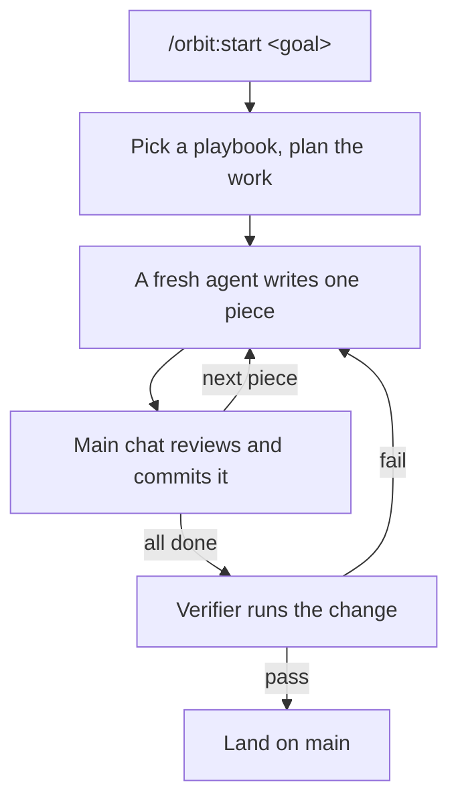

Claude Code is good at writing code and bad at knowing when it's done. It says a fix works because the tests pass. It asks me which approach I want when it could try both and look. And if I leave it alone for an hour, I come back to a pile of changes I now have to check myself.

[orbit](https://github.com/aayushbtw/orbit) is the plugin I use to fix that. I type a goal in one line. orbit plans the work, has it written in small pieces, reviews each piece, and lands nothing until a separate agent has run the result the way I would.

```sh
claude plugin marketplace add aayushbtw/orbit && claude plugin install orbit@orbit
```

## What a task looks like

Every task starts with one command and a goal.

```
/orbit:start fix the flaky chat-scroll tests
```

From there, every change goes through the same loop.



1. **It picks a playbook.** orbit reads the goal and decides what kind of work it is, such as a bug, a feature, a refactor or a question. Each kind has its own steps. A bug, for example, has to be reproduced before anyone writes the fix.
2. **It works in its own copy of the repo.** Each change gets its own git worktree, so two sessions on one project never touch the same files.
3. **A big plan gets a second opinion.** If the change adds a module or touches more than 3 files, a read-only reviewer checks the plan before any code exists.
4. **A fresh agent writes each piece.** The main chat doesn't write code. It hands one small piece at a time to a new agent, reads the diff, runs the project's checks and commits it before the next piece starts.
5. **A verifier runs it before it lands.** Another new agent, one that can't edit files, runs the change and the commit before it the way a user would, and returns pass or fail. A fail sends the work back.
6. **It lands.** By default that's a fast-forward of `main`. A project that works through PRs can have orbit open and merge a PR instead.

Steps 4 and 5 are the point. The agent that wrote the code is the worst one to judge it, because it checks what it meant to build, not what it built.

Every reply ends with one `Next:` line that says what's left. `Next: nothing pending.` means the work is on `main`.

## What I type

Most of my goals are one lowercase line, and the wording picks the playbook.

- `fix the flaky chat-scroll tests` reproduces the bug, fixes it and lands the fix.
- `why are we on this branch?` answers with citations and changes nothing.
- `sketch two layouts to decide` builds throwaway versions, shows both and recommends one.
- `autopilot this queue: <items>` takes each item to `main` on its own.
- Ending a goal with "im stepping away" makes orbit log every decision with its evidence, so I can review the run when I'm back.

A few words change how far it goes. "don't ship" stops before landing, and `/orbit:ship` lands it later. "going to bed" keeps it running instead of stopping to ask. `/orbit:pause-safely` stops cleanly and leaves a note the next session picks up from.

It also asks me fewer questions. When Claude is about to ask which approach I want, orbit's rules make it check whether running something would answer the question. On one run, a plan assumed subagents can't start their own subagents. Instead of asking me, orbit tested it in an empty repo, had the answer 12 seconds later, and changed the plan.

## Where it comes from

Most of orbit is [pstack](https://github.com/cursor/plugins/tree/main/pstack), Lauren Tan's plugin built from the agent workflows Lauren uses every day at Cursor. orbit copies it at one fixed commit and ports it to Claude Code. It adds the `/orbit:start` command, rules loaded into every session, the plan reviewer, and landing by default. Every place orbit differs from pstack is listed with a reason in [docs/pstack-differences.md](https://github.com/aayushbtw/orbit/blob/main/docs/pstack-differences.md).

## Where to start

Don't let it land anything on day one. Give it one small bug with "don't ship" at the end, read the diff and the reply, and run `/orbit:ship` yourself when you're happy.

Before you drop "don't ship", run `/orbit:create-verification-skill`. It writes a skill that teaches the verifier how to launch and drive your app. Without one, the verifier falls back to a generic browser or terminal driver.

## Limitations

- **Claude Code only.**
- **Every change runs the full loop.** A one-line fix still gets a fresh agent, a review and a verifier.
- **It spends more tokens than a plain session.** Each piece and each verifier starts a new agent.
- **Routing is a rate.** A goal typed without `/orbit:start` goes through orbit most of the time, not every time. [Part 2](/writings/what-the-verifier-caught) has the numbers.

## Try it

The [repo](https://github.com/aayushbtw/orbit) has the install steps, and [docs/usage.md](https://github.com/aayushbtw/orbit/blob/main/docs/usage.md) lists every command. [Part 2](/writings/what-the-verifier-caught) is the change that passed every test and still broke orbit, and how the verifier caught it.
