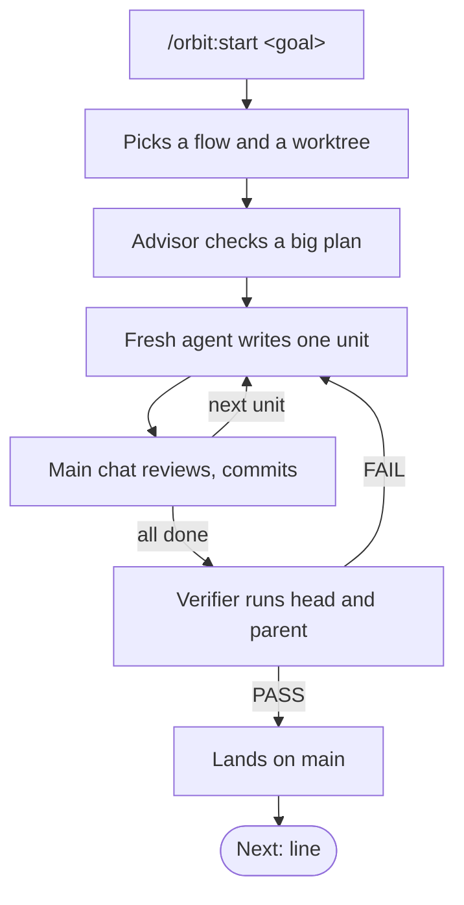
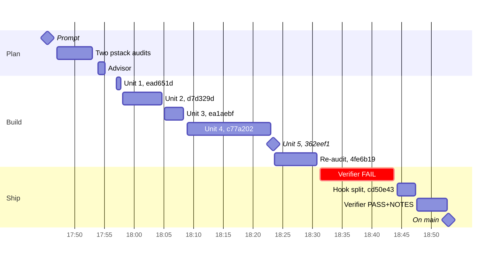

Orbit is a Claude Code plugin that takes a goal from one prompt to a verified change on `main`. I type what I want. Orbit picks a flow, hands each piece of code to a fresh agent, reviews every diff, and lands nothing until an agent that wrote none of it has run it. Most of it is Lauren Tan's pstack, ported to Claude Code.

## Install it with one line

```sh
claude plugin marketplace add aayushbtw/orbit && claude plugin install orbit@orbit
```

Inside a session, the same two steps are `/plugin marketplace add aayushbtw/orbit` and `/plugin install orbit@orbit`. Claude Code leaves auto-update off for third-party marketplaces, so update with `claude plugin update orbit@orbit`, or turn auto-update on in the Marketplaces tab of `/plugin`. Orbit's rules load at the start of every session, and your own CLAUDE.md stays yours.

## Every change runs the same loop



- `/orbit:start` reads the goal and picks a flow, such as bug, feature, refactor or a read-only question. Large work, or work I walk away from, goes to `/orbit:figure-it-out`, which designs its own steps.
- A change gets its own git worktree, so two sessions on one project never share a checkout.
- When the plan adds a module or touches more than 3 files, the advisor, a read-only agent on Opus, reviews it before any code exists.
- A fresh agent writes each unit. The main chat reads the diff, runs the check and commits the unit before the next agent starts. In pstack's feature playbook, the gain is "review separation, not lines saved".
- Before anything lands, a fresh verifier with no Edit or Write tool checks out the head and the parent, runs both the way a user would, and returns PASS, PASS+NOTES or FAIL.
- A pass lands. With no Land line in the project's AGENTS.md, that is a fast-forward of `main`. With `Land: pr`, it is a merged PR.
- The reply ends with one `Next:` line that says what is left.

## Most of the loop is pstack

[pstack](https://github.com/cursor/plugins/tree/main/pstack) is Lauren Tan's plugin for rigorous agent workflows, built from the skills Lauren uses every day at Cursor. Orbit copies it at one pinned commit, including its playbooks, all 24 principles and the agents that write and clean up the code. Orbit adds rules printed at the start of every session, `/orbit:start`, a git agent, the advisor and landing by default. Every place orbit differs has a row and a reason in [docs/pstack-differences.md](https://github.com/aayushbtw/orbit/blob/main/docs/pstack-differences.md).

## One real run, minute by minute

On October 30 I gave orbit this goal.

```
/orbit:start close the remaining pstack-differences gaps (rules.md rows, pin vs newer-upstream text), then the portfolio docs series dont push portfolio docs without my approval ill check everything locally 1st.
```

Each bar runs from an agent's start to its report, commit or verdict.



- At 17:46 orbit routed the goal to `/orbit:figure-it-out`, and two agents audited orbit against pstack in parallel.
- At 17:55 the advisor approved the plan with changes. One change dropped a step that would have deleted orbit's `docs/` folder, because "nothing in the request asks for it."
- From 17:57 to 18:23, five units became five commits. Units 2 and 4 were the hardest, so their agents ran on Opus.
- By 18:30 a fresh agent had re-audited the result against pstack. It found one contradiction and one dropped sentence, and a fix round closed both.
- At 18:43 the verifier returned FAIL. Plain goals had stopped going through `/orbit:start`, in 6 runs out of 6. [Part 2](/writings/what-i-type-into-orbit) has the story.
- At 18:53, after a fresh agent split the hook that loads orbit's rules and a second verifier passed it with notes, the change was on `main`.

The orbit half took 68 minutes from my prompt to `main`. The portfolio half stopped where I told it to, and the run ended with this line.

```
Next: /orbit:start push the portfolio Orbit series (after you've reviewed it locally)
```

Every orbit run ends on one line like that, and it is a status, not an offer. [Part 2](/writings/what-i-type-into-orbit) covers what I type to start the next run.
