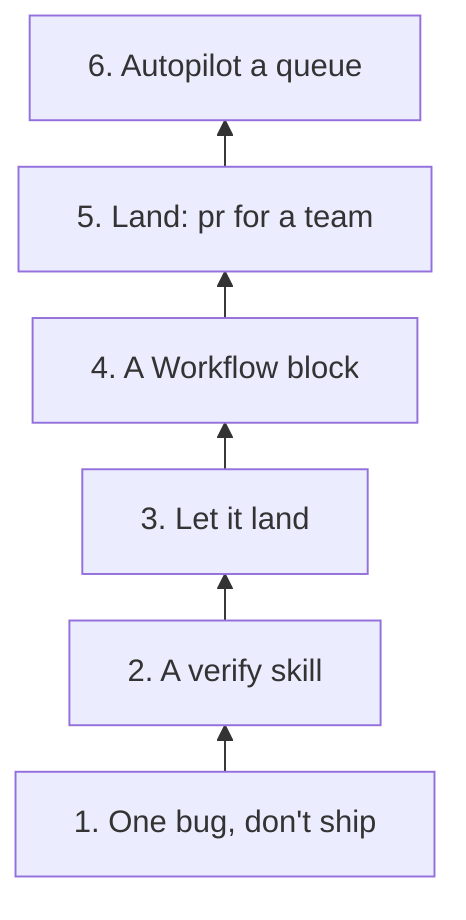

The first thing I would give orbit in a new project is one small bug with "don't ship" in the goal. The last is a queue of changes it builds, verifies and lands without me. Each step in between lets orbit do one more thing on its own, and I would take a step only after the one before it has held up.



## The first task is one bug orbit may not ship

```
/orbit:start fix the flaky chat-scroll tests, don't ship
```

Orbit runs the whole bug flow on it. It reproduces the bug, commits the failing repro before the fix, reviews each unit and runs the check. Then it stops at a branch in its worktree and ends with `Next: /orbit:ship`. I read the diff and the reply, and `/orbit:ship` lands the change once a verifier has run it.

## A verify skill comes before letting it land

```
/orbit:create-verification-skill
```

It reads the repo, asks only what it cannot find there, and writes `.claude/skills/verify-<app>/`. The skill covers these.

- How to launch the app, and how to tell when it is ready.
- One read-only health check.
- How to drive the app with the repo's real selectors and commands.
- What evidence to keep, and how to clean up without deleting it.

A feature map adds one file per feature, with how a user reaches it and what end state proves it worked. Orbit runs the new skill once from launch to cleanup before it hands it over.

When the app changes, `/orbit:maintain-verification-skill` checks each feature file against the source, drives every feature live, and reports real bugs instead of rewriting the map around them. A project without a verify skill still gets verified, through orbit's `control-ui` for browser and Electron apps or `control-cli` for CLIs and TUIs. Orbit's differences doc gives the reason to prefer your own, "A project's own verify skill knows its app."

With the skill in place, I would drop "don't ship". Every change still stops for the verifier, which drives the app through the skill, head against parent, before anything lands.

## The Workflow block holds what your project does differently

Orbit's defaults assume Vite+, a worktree per change and a fast-forward onto `main`. A project that differs adds a `## Workflow` block to its AGENTS.md and lists only what differs.

```md
## Workflow

- Check: `vpr check`, plus `vpr e2e` when the UI changed.
- Land: `pr`
- Before code: `src/server/: node_modules/effect/AGENTS.md`
- Review also checks: `docs/architecture.md`.
```

- Check replaces the default `vpr check`, `vpr build` and `vpr test`.
- Land picks `pr` over the default `main`, plus a merge method if it is not squash.
- Before code names a source for a path, such as a library's agent guide. Every code agent working under that path loads it before it writes.
- Review also checks names docs that the plan gate and reviews read.

The template is `templates/workflow-block.md` in orbit's repo.

## Teams land through PRs, and a queue can run on its own

`Land: pr` keeps pstack's path. Opening a PR opens a ready PR. Babysit takes it to merge-ready through review threads and CI, and it reports a conflict instead of resolving it. Shipping merges the PR once a verifier passes its head.

The last step is a queue. `/orbit:start autopilot this queue: <items>` gives each item its own owner on Opus in its own worktree, and items I name as mine stop at merge-ready. When I want to review before anything merges, "build the stack, I'll land it" hands me one stack to land with `/orbit:ship`.

## Orbit's own rules come from its failures

On October 29 orbit's git agent pushed while a rebase was stopped on a conflict in `.claude-plugin/plugin.json`. Its report opened with "Stopped mid-rebase. The rebase hit a conflict, and my push sent the partial HEAD." `main` got the first of two units. Nothing broke, because that unit had been verified on its own. But gitops had no rule for a conflict, and pstack's babysit playbook did.

> A conflict is the one blocker you report rather than resolve. Say which branch needs the rebase and stop.

Orbit had lost that sentence when it folded three pstack playbooks into one ship command. Six minutes after the report, I typed `/orbit:start split ship into pstack's opening-a-pr, babysit and shipping playbooks`. gitops now carries pstack's sentence and one line of orbit's own, "Never push while a rebase or merge is in progress." The verifier's FAIL in [Part 2](/writings/what-i-type-into-orbit) became a rule too. The differences doc's row on loading rules now explains the 10 KB limit and why there are two hooks.

## pstack is copied at one commit, and every difference is written down

On October 24 I found out that orbit had dropped two core parts of pstack, coding in a subagent and a worktree per task. The comparison meant to catch that had compared files, not the flow text inside them. Later that day Claude rated a pstack skill low value because orbit's own wording overlapped with it. My reply set the rule for everything after.

```
copy pstack instead. dont invent anything yet.
```

Orbit copies pstack at commit `9580c23`, and 55 of the 56 entries in `skills.json` point at it. The other one, the playbook scripts, comes from a later commit, because at the pin those scripts still carry a tool that upstream later removed. Every place orbit differs has a row in [docs/pstack-differences.md](https://github.com/aayushbtw/orbit/blob/main/docs/pstack-differences.md) that quotes pstack at the pin, says what orbit does and gives the reason. Shipping by default is my call, and its row cites what I wrote on October 29.

```
ill be writing more ship it when verified. than if it was dont ship until i say so
```

A rule with no source goes, even one in my favor. On October 30 orbit deleted a line from `rules.md` that said my own CLAUDE.md format and length rules win. It had no pstack source, and nothing recorded that I had asked for it.

Reading orbit against pstack by eye is not enough, so a script checks it. On the October 30 run, the advisor's verdict on another read-through was "Not strong enough alone. Add the script." The checker fails on a `skills.json` entry off the pin without a row, on any orbit sentence that carries text pstack added after the pin, and on any quote in the pstack column that does not exist at the pin. Its first run found 20 hits of post-pin text. Restoring autopilot-stack to the pinned text brought that to 11, and reverting the rest brought it to 0.

```
post-pin sentences checked: 135; failures: 0
```

Moving the pin to a newer pstack is a separate job. That is the day pstack's rule to restate the user's goal first comes in, since it only exists after the pin.
