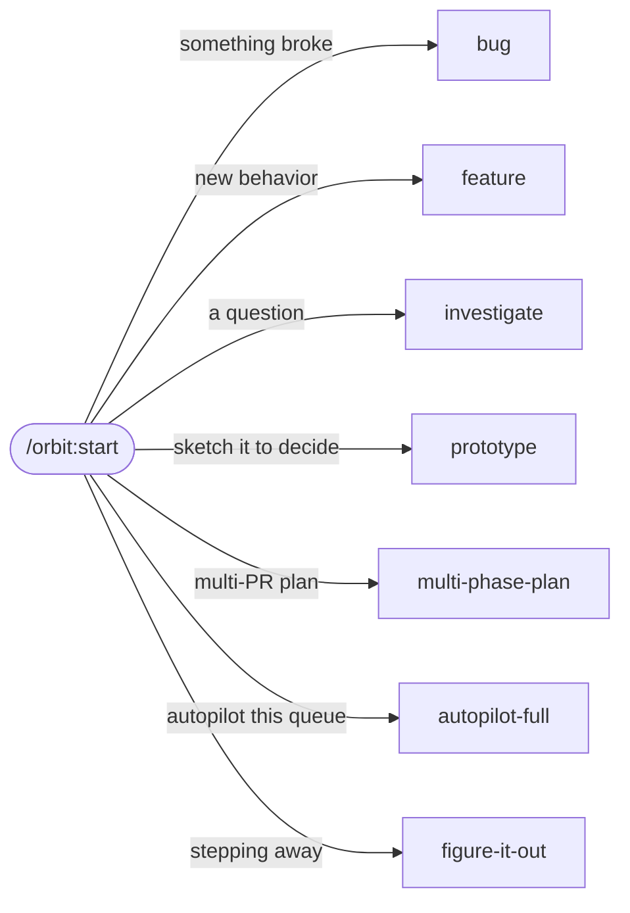

On October 29 I typed one word after `/orbit:start`, and the word was "autopilot". Claude had just listed five pieces of pstack that orbit was missing. 57 minutes later all five were on `main`, each built by its own agent and verified by an agent that never wrote it. I give orbit the goal and never the steps, and most of my prompts are one lowercase line.

## One command picks the flow from the goal

Every kind of work below starts with `/orbit:start <goal>`. It reads the goal, picks a flow and writes that flow's steps as a todo list. A step it skips stays on the list with the reason.



- Something broke. I typed `/orbit:start fix the flaky chat-scroll tests`. The bug flow reproduces the bug on the real surface first, narrows the cause with evidence, and commits the failing repro before the fix.
- New behavior, as in `/orbit:start share the asset card with /projects (once fix/assets-ui is on main)`. The feature flow reads the subsystem with `/orbit:how`, sketches the shape with `/orbit:architect`, and builds one unit at a time.
- A question, as in `/orbit:start why are we on this branch? do we have things to merge or pending?` It runs the read-only investigate flow, answers with citations and commits nothing. `/orbit:how` explains how a subsystem works, and `/orbit:why` explains why code is the way it is.
- An open fork. Putting "sketch it to decide", "mock it up" or "try this layout" in the goal runs the prototype flow. It builds each option as throwaway code in a scratch folder, shows the output or a screenshot of each, recommends one and ships nothing.
- Work across several PRs, as in `/orbit:start multi-PR plan: move orbit's pin to newer pstack`. The flow settles open questions with prototypes, writes a checklist with one section per PR, lints it with a script, and waits for my go.
- A queue, as in `/orbit:start autopilot this queue: <items>`. Each item gets its own owner and worktree, and a fresh verifier checks every head before its owner merges it. With "build the stack, I'll land it", orbit verifies the same way and hands me one stack of PRs to land.
- Work I walk away from. I ended one goal with "how we do it up to you. take ownership, im stepping away." That routes to `/orbit:figure-it-out`, which logs every decision to a TSV trail with its evidence and has a reviewer on a different model read the trail before it hands back.

## A few words steer a run

- Adding "don't ship" or "I'll land it" to the goal stops the change at its branch, or at its PR under `Land: pr`. `/orbit:ship` lands it later, after the verifier.
- Saying "do it" or "continue" resumes the todo list, and "new task" starts a fresh one.
- Saying "don't stop" or "going to bed" keeps the run going instead of pausing.
- `/orbit:pause-safely` stops at a safe point, commits a `wip:` checkpoint and writes a resume note outside the repo. In a new session, `/orbit:session-pickup` reads that note, the transcript and the git log, and carries on without redoing finished work.

## The Next line says what is left

Every reply ends with one `Next:` line. It is a status, not an offer.

- `Next: nothing pending.` means the goal is done, and any change it made has landed.
- `Next: /orbit:ship` means I said "don't ship", and the branch or PR is waiting for me.
- `Next: /orbit:start <follow-up>` means the rest is outside the goal or needs my call, and the reply says which.
- `Next: new session, then /orbit:session-pickup` means the run paused.

## It runs a test before it asks me

`rules.md` has a rule for the moment Claude is about to ask me which approach to take. If running something would show the answer, the question is not mine, and Claude sketches it instead. The same habit caught a wrong fact in a plan. On October 29 a plan to port pstack's autopilot said each owner had to be a separate Claude Code session, "since subagents can't nest". Before anything was built on that, the run tested it in an empty repo.

```sh
claude -p --max-budget-usd 2 --output-format stream-json --verbose 'Use the Agent tool to spawn ONE general-purpose subagent with this exact prompt: "Use the Agent tool to spawn one general-purpose subagent whose only job is to reply with the word NESTED-OK. Report exactly what it replied, or report the exact error / say that you have no Agent tool." Then tell me verbatim what the subagent reported.'
```

Twelve seconds later the answer was "The subagent replied `NESTED-OK`." Owners became subagents in their own worktrees, and the decision trail recorded why. Nobody asked me whether subagents can nest, and nobody should have.

## Letting it land is safe because the verifier runs it first

The run in [Part 1](/writings/one-prompt-to-main-in-68-minutes) passed every check I had. All 61 script tests passed, `claude plugin validate` passed, and a drift checker went from 20 hits of post-pin text to 0. Then the verifier built a scratch repo and gave Claude Code a plain goal, with no skill named, against the old plugin and the new one.

```sh
claude -p "Add a --version flag to cli.js that prints the version from package.json." --plugin-dir <checkout> --add-dir <checkout> --max-turns 3 --permission-mode acceptEdits --disallowedTools=EnterWorktree,Agent --output-format stream-json --verbose
```

On the parent commit, Claude's first call was `/orbit:start` in 3 runs out of 3. On the new commit it never was, in 6 runs out of 6. The new `rules.md` printed 12,609 characters, and Claude Code puts about 10 KB of a hook's output into the session. Past that, the session gets a 2 KB preview, and the line that routes a plain goal sat at character 11,600. The verifier cut a copy to 9,634 characters, and routing came back in 2 runs out of 2. Its report said "Size is the cause, not the new wording."

The fix prints `rules.md` through two hooks, split at `# Code Quality`, with the routing line moved to the top.

<!-- ::chart name="orbit-hook-output" -->

A second verifier ran the same goal 12 times on the fix, and 11 runs started with `/orbit:start`. It got 5 out of 9 on the parent, so routing is a rate. Even so, 0 out of 6 meant orbit never ran for a plain goal, and the split brought it back.

<!-- ::chart name="orbit-routing" -->

None of the other checks started a session and typed a goal into it. The verifier exists for that. It has no Edit or Write tool, checks out the parent and the head, and runs both the way a user would. pstack's shipping playbook counts a verdict only from an agent that did not write the code, "because an author checks what it meant to build."

One thing from that run is still open. No test fails if either hook's output grows past the limit again, so the verifier is still the only check that would catch it.
